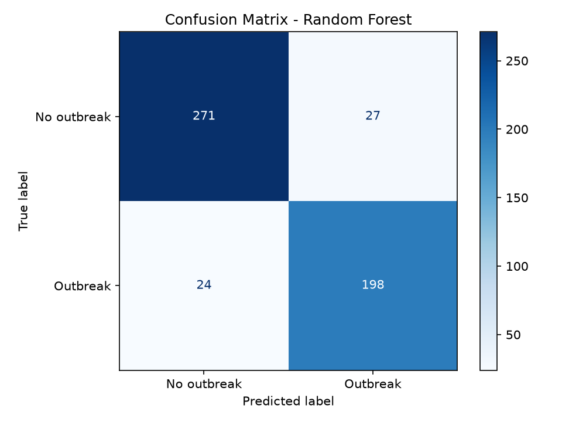
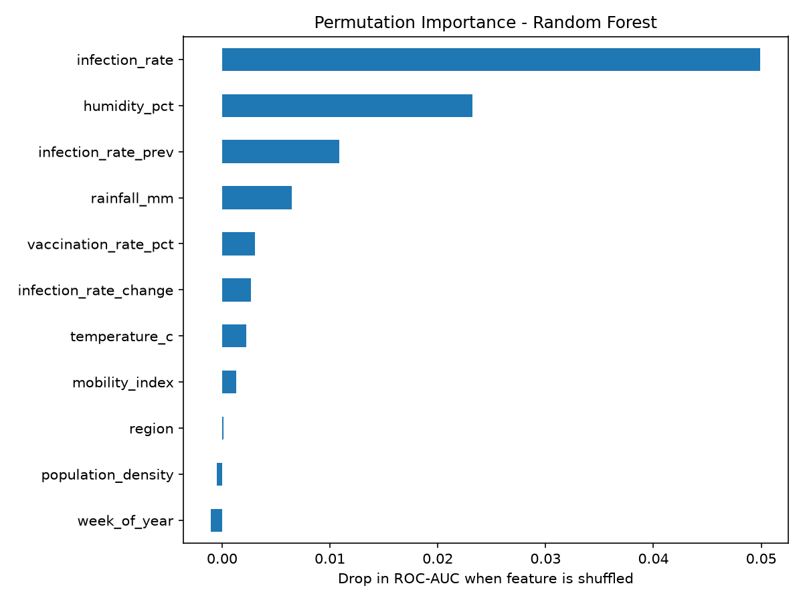

# Disease Outbreak Prediction (AI/ML)

Predict whether a region will experience a **disease outbreak next week** from this week's weather,
demographic and surveillance data. Built as part of the AICTE × TechSaksham (Microsoft & SAP) AI internship.

> ⚠️ **About the data — please read.** Real outbreak-surveillance data is not available as one clean,
> free download, so `generate_data.py` creates a **simulated** dataset (10 regions × 5 years of weekly
> records, with seasonal weather, missing sensor readings and noisy transmission dynamics). Results
> therefore demonstrate the **ML workflow**, not real epidemiology, and the model must not be used for
> real-world decisions. The pipeline accepts a real CSV with the same columns (see below).

## What the project does
1. **Data** — `generate_data.py` simulates weekly records: temperature, humidity, rainfall, population
   density, vaccination rate, mobility index, current and previous infection rate (cases per 100k).
   Label: `outbreak_next_week = 1` if next week's incidence ≥ 60 per 100k.
2. **Preprocessing** — one scikit-learn `Pipeline`: median imputation for missing values (replacing the old
   forward-fill), standardisation, one-hot encoding of `region`.
3. **Honest evaluation** — a **time-based split** (train on years 1–4, test on year 5), so the model is never
   tested on data from before its training period. Models are chosen with `TimeSeriesSplit` cross-validation.
4. **Baselines** — compared against "outbreak now ⇒ outbreak next week" and a majority-class guess.
5. **Interpretation & deployment** — permutation feature importance, saved model, and `predict.py`.

## Results (held-out final year, 520 rows)

| Model | Accuracy | Precision | Recall | F1 | ROC-AUC |
|---|---:|---:|---:|---:|---:|
| Logistic Regression | 0.900 | 0.873 | 0.896 | 0.884 | 0.967 |
| **Random Forest** (best by CV) | **0.904** | 0.881 | 0.896 | 0.888 | 0.967 |
| Gradient Boosting | 0.898 | 0.866 | 0.901 | 0.883 | 0.967 |
| Baseline: persistence | 0.879 | 0.857 | 0.860 | 0.858 | — |
| Baseline: majority class | 0.427 | — | — | — | — |

**Reading these numbers honestly:** the models beat the naive "outbreak now ⇒ outbreak next week" baseline
by only ~2–3 accuracy points, because outbreaks in this simulation are strongly persistent. The three models
are essentially tied, so the simple, interpretable logistic regression is just as good a choice. The top
drivers are the current infection rate, humidity, the previous week's infection rate and rainfall.

| Confusion matrix | Feature importance |
|---|---|
|  |  |

## How to run
```bash
pip install -r ../requirements.txt
python main.py                 # trains, evaluates, saves model + plots + metrics
python predict.py --example high   # or: --example low, or pass your own values (see --help)
```
Outputs: `models/outbreak_model.joblib`, `outputs/*.png`, `outputs/metrics.json`.
To regenerate the simulated data: `python generate_data.py`.

### Using real data
Provide a CSV with these columns and run `python main.py --data your_file.csv`:
`region, week_index, week_of_year, temperature_c, humidity_pct, rainfall_mm, population_density,
vaccination_rate_pct, mobility_index, infection_rate, infection_rate_prev, outbreak_next_week`
(`week_index` = consecutive week number used for the time-based split).

## Files
| File | Purpose |
|---|---|
| `generate_data.py` | Simulates the dataset (`data/outbreak_data.csv`) |
| `main.py` | Training, cross-validation, evaluation, plots, model saving |
| `predict.py` | Predict outbreak probability for one region from the saved model |

## Limitations
- Simulated data; the relationships are those I wrote into the simulator, so feature importances reflect that.
- Weekly, region-level, single-step forecast only; no spatial spread between regions.
- Not validated on real outbreaks. Not medical or public-health advice.
