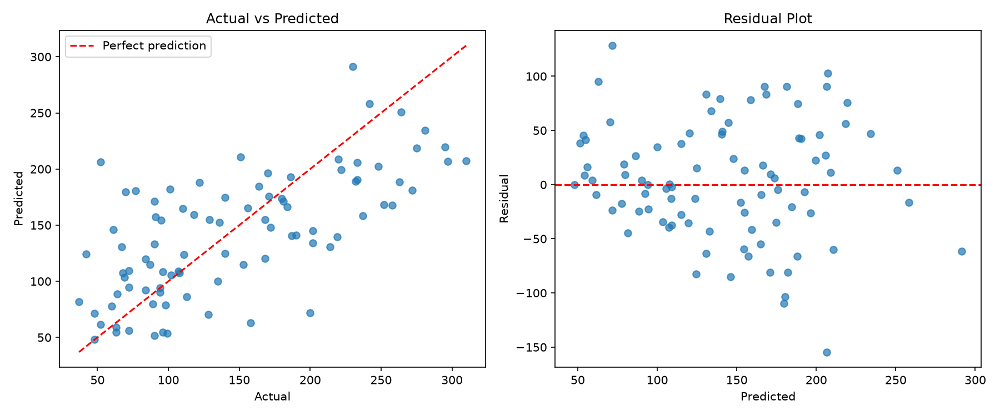

# Task 3 — Linear Regression (Simple & Multiple)

## Objective
Fit simple and multiple linear regression models on a **real** dataset, evaluate them properly,
and check the model's assumptions.

## Dataset
scikit-learn's **Diabetes dataset** — 442 patients, 10 baseline features (age, sex, bmi, bp, s1–s6
blood-serum measures). The target is a quantitative measure of disease progression one year later.
It ships with scikit-learn, so no download is needed.

> An earlier version of this task used randomly generated house prices built from a fixed formula,
> which only proved the model could recover that formula. It has been replaced with real data.

## Results (20% hold-out test set, `random_state=42`)

| Model | MAE | RMSE | R² |
|---|---:|---:|---:|
| Simple regression (BMI only) | 52.26 | 63.73 | 0.233 |
| Multiple regression (all 10 features) | 42.79 | 53.85 | 0.453 |

- Using all features roughly doubles the explained variance, but R² ≈ 0.45 shows plenty of
  variation remains unexplained — realistic for noisy medical data.
- **Multicollinearity:** Variance Inflation Factors for `s1` (59) and `s2` (39) are far above 10, so
  their individual coefficients are unreliable even though the overall predictions are fine.



## How to run
```bash
pip install -r ../requirements.txt
python task3_linear_regression.py
```

## Interview Questions & Answers 

1. What assumptions does linear regression make?

Linearity, independence, homoscedasticity (equal variance), normality of residuals, no multicollinearity.

2. How do you interpret the coefficients?

Each coefficient represents the change in the target variable for a one-unit change in the feature, keeping other variables constant.

3. What is R² score and its significance?

R² indicates how much of the variance in the dependent variable is explained by the model (0–1 scale).

4. When would you prefer MSE over MAE?

Use MSE when you want to penalize larger errors more strongly.

Use MAE when all errors should be treated equally.

5. How do you detect multicollinearity?

Using VIF (Variance Inflation Factor) or correlation heatmaps.

6. Difference between simple & multiple regression?

Simple Regression: One independent variable.

Multiple Regression: Two or more independent variables.

7. Can linear regression be used for classification?

Not directly. For classification tasks, Logistic Regression is used instead.

8. What happens if you violate regression assumptions?

Leads to biased coefficients, unreliable predictions, and poor generalization.
