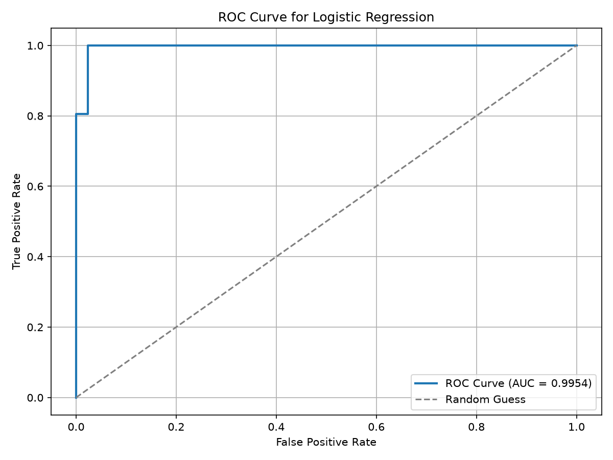
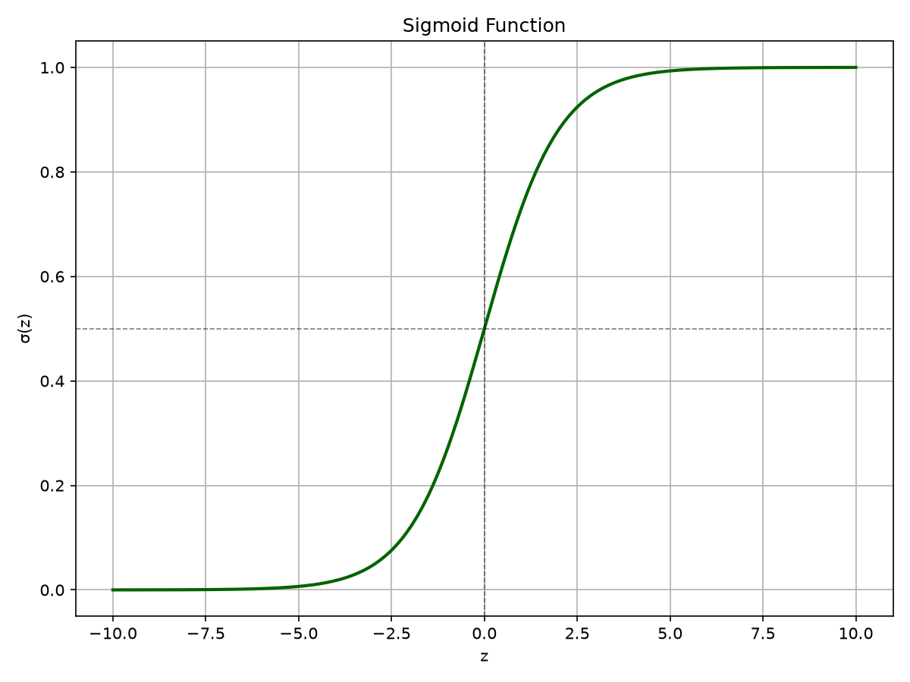

# Task 4 — Logistic Regression

## Objective
Predict whether a breast tumour is malignant or benign using the Breast Cancer Wisconsin dataset
(569 samples, 30 features; bundled with scikit-learn).

## Workflow
1. Load the data and check class balance (357 benign, 212 malignant).
2. Stratified 80/20 train/test split (455 / 114).
3. Standardise features with `StandardScaler` (fitted on the training set only).
4. Train `LogisticRegression`.
5. Evaluate with accuracy, precision, recall, F1, ROC-AUC and a confusion matrix.
6. Plot the ROC curve, confusion matrix and the sigmoid function.

## Results

| Metric | Result |
|---|---:|
| Accuracy | 98.25% |
| ROC-AUC | 0.9954 |
| Training / testing samples | 455 / 114 |

```text
Confusion matrix (rows = actual, cols = predicted; malignant, benign)
[[41  1]
 [ 1 71]]
```
112 of 114 test samples were classified correctly.

| ROC curve | Sigmoid function |
|---|---|
|  |  |

## How to run
```bash
pip install -r ../requirements.txt
python task4_logistic_regression.py
```
Figures are saved to `outputs/`.

## Interview Questions

**1. Why is Logistic Regression used for classification?**

It estimates the probability of a class and can classify observations using a decision threshold.

**2. What is the sigmoid function?**

It maps a real-valued input to a probability-like value between 0 and 1.

**3. Why do we use feature scaling?**

Scaling puts features on comparable ranges and can help optimization converge more effectively.

**4. What is the difference between precision and recall?**

Precision measures the reliability of positive predictions, while recall measures how many actual positive cases are detected.

**5. What does ROC-AUC represent?**

It measures the model's ability to distinguish between the two classes across different classification thresholds.

**6. What is a confusion matrix?**

It summarizes true positives, true negatives, false positives, and false negatives.

**7. Why is the train-test split important?**

It evaluates how well a model generalizes to data it did not train on.

**8. Why might accuracy be misleading on imbalanced data?**

A model can achieve high accuracy by favoring the majority class while performing poorly on the minority class.
