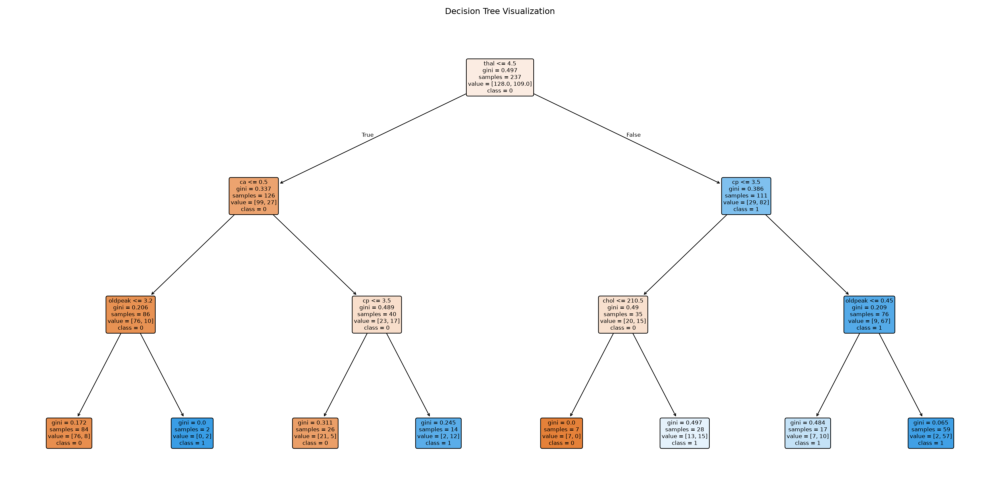
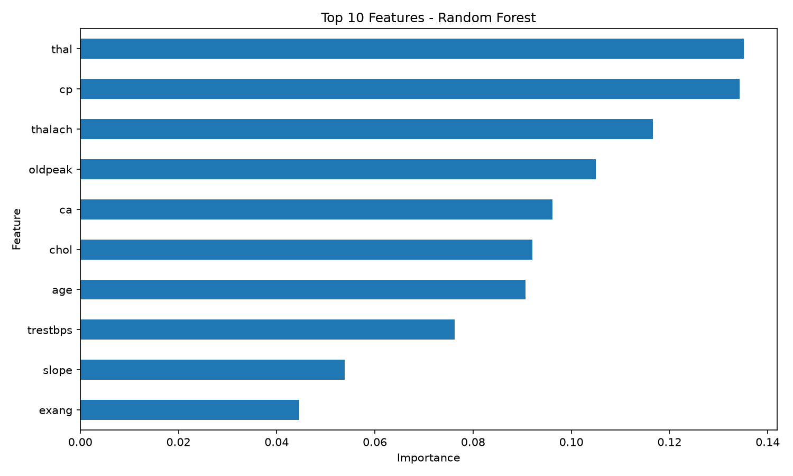

# Task 5 — Decision Trees & Random Forests

## Objective
Classify heart-disease patients with a single decision tree and a random forest, and compare them.

## Dataset
`dataset.csv` — the UCI **Cleveland Heart Disease** data: 297 patients, 13 features (age, sex, chest-pain
type `cp`, resting blood pressure, cholesterol, max heart rate `thalach`, `oldpeak`, `ca`, `thal`, …).
The original 0–4 diagnosis is binarised: `target = 1` → heart disease present, `0` → absent
(137 positive, 160 negative). Rows with missing values were already removed.

## Method
- Stratified 80/20 split (237 train / 60 test), `random_state=42`.
- Decision tree with `max_depth=3` (kept shallow so it stays interpretable and doesn't overfit).
- Random forest with 200 trees.
- 5-fold cross-validation on the training data only; feature importance from the forest.

## Results

| Model | Test accuracy | 5-fold CV accuracy |
|---|---:|---:|
| Decision Tree (depth 3) | 80.00% | 80.12% |
| Random Forest (200 trees) | 86.67% | 82.64% |

The forest is better on both measures. With only 60 test patients, one patient is worth ~1.7 points,
so the cross-validation figures are the more trustworthy comparison — the real gap is a few points,
not ten. Most important features: `thal`, `cp`, `thalach`, `oldpeak`, `ca`.

| Decision tree | Feature importance |
|---|---|
|  |  |

## How to run
```bash
pip install -r ../requirements.txt
python task5_decision_tree_rf.py
```

## What I learned
- How trees split on Gini impurity/entropy and why depth controls over-fitting.
- Bagging and random feature selection: why a forest is more stable than one tree.
- Why cross-validation matters on small datasets.
