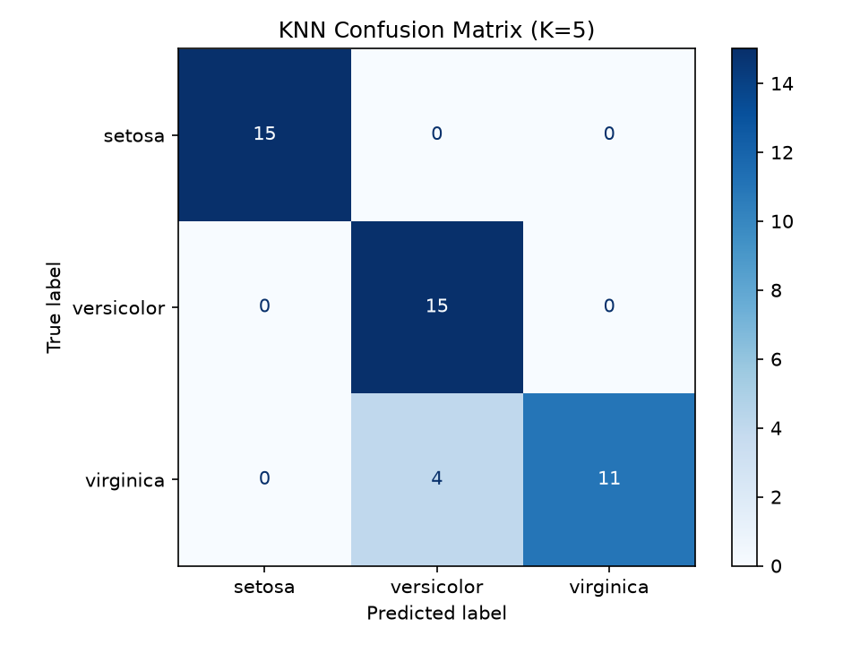

# Task 6 — K-Nearest Neighbors (KNN)

## Objective
Classify Iris flowers with KNN and see how the choice of K affects accuracy.

## Dataset
Iris, loaded from scikit-learn: 150 samples, 4 numeric features, 3 classes.

## Method
1. Stratified 70/30 split (105 train / 45 test), `random_state=42`.
2. `StandardScaler` fitted on the training data only (KNN is distance-based, so scale matters).
3. Train KNN for K = 3, 5, 7 and compare test accuracy.
4. Confusion matrix for the K=5 model.

## Results

| K | Test accuracy |
|---|---:|
| 3 | 91.11% |
| 5 | 91.11% |
| 7 | 93.33% |

K=7 scored highest here, but with 45 test samples the gap is a single flower, so it is not strong
evidence that 7 is "better". The confusion matrix is shown for K=5.



## How to run
```bash
pip install -r ../requirements.txt
python knn_classification.py
```

## Key learnings
- How KNN votes among the nearest neighbours.
- Why feature scaling matters for distance-based methods.
- How K trades off noise sensitivity (small K) against over-smoothing (large K).
